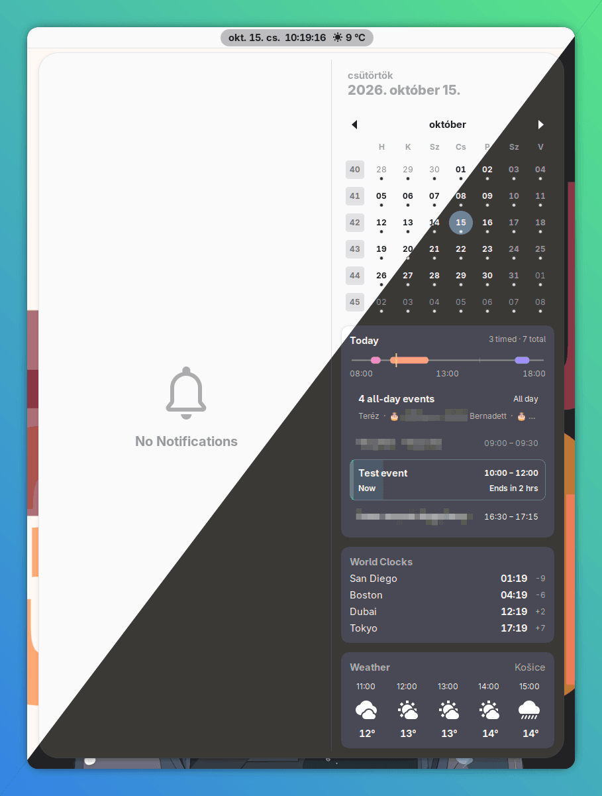

# Splendid Agenda

A compact agenda for the GNOME Shell clock menu, with a daily timeline, event
counts, grouped all-day events, and live event progress. Supports light and dark
themes, with optional dimming of completed events.

Uses your existing GNOME calendars and accounts. Select a day in the calendar to
see its events. Disabling the extension restores GNOME's built-in agenda.



## Install

Requires **GNOME Shell 51**, Git, GNU Make, GNU gettext, and the GNOME Shell extension and GLib
tools. You can check your GNOME version in **Settings → System → About**.

1. Open Terminal and paste these commands, one at a time:

   ```bash
   git clone https://github.com/7system7/splendid-gnome-agenda.git
   make -C splendid-gnome-agenda install
   ```

2. Save your work, then log out and back in.

3. Open the downloaded **splendid-gnome-agenda** folder in Files, right-click its
   empty space, and choose **Open in Terminal**. Run:

   ```bash
   make enable
   make info
   ```

   Look for **State: ACTIVE**, then click the clock to open your agenda.

Run all commands below from a terminal opened in that project folder.

## Preferences

```bash
make prefs
```

All options are enabled by default and changes apply immediately.

| Option | What it does |
|---|---|
| **Group all-day events** | Combines all-day events into one summary row. Turn off to show separate rows. |
| **Dim past events** | Fades completed events while keeping current and upcoming events fully visible. |
| **Pulse ongoing event borders** | Gently pulses the border of “Now” events. Turn off for a steady border; progress and remaining time stay visible. Requires GNOME animations to be enabled. |
| **Show availability line** | Shows the daily timeline and its time labels. Turn off to hide both while keeping the event list. |

Calendar accounts and calendar visibility are managed in GNOME.

The interface follows your desktop language. English and Hungarian are included;
other languages fall back to English.

## Manage the extension

| Command | What it does |
|---|---|
| `make install` | Install or rebuild from the downloaded source. Log out and back in afterward to load changes. |
| `make enable` | Turn the extension on. |
| `make disable` | Turn it off and restore the built-in agenda. |
| `make uninstall` | Remove it. Log out and back in afterward. |
| `make info` | Check whether it is active. |
| `make logs` | Show Shell logs for troubleshooting; press Ctrl+C to stop. |
| `make help` | List all available commands. |

If changes do not appear, log out and back in, then run `make enable` and
`make info`. An installed extension must report **State: ACTIVE** to be running.
If installation reports a missing tool, install the required package through
your distribution's software manager and try again.

## Development

`make check` checks JavaScript syntax, validates settings, and runs tests; it
requires Node.js. Use `make test` for tests only and `make pack` to create a ZIP
in the `build` folder.

Translations live in the extension's `po` folder. Run `make translations` to
refresh the template and catalogs after changing interface text. Edit `en.po`
or `hu.po`, then run `make check` to validate them. `make pack` and `make install`
automatically compile and include the translations.

For a nested test desktop, run `make install`, then `make isolated` (requires
Mutter Devkit support). Run `make enable` and `make info` from a terminal **inside
that desktop**. Restart the nested Shell after installing changes. The nested
session shares your installed extensions and settings with your normal desktop.
